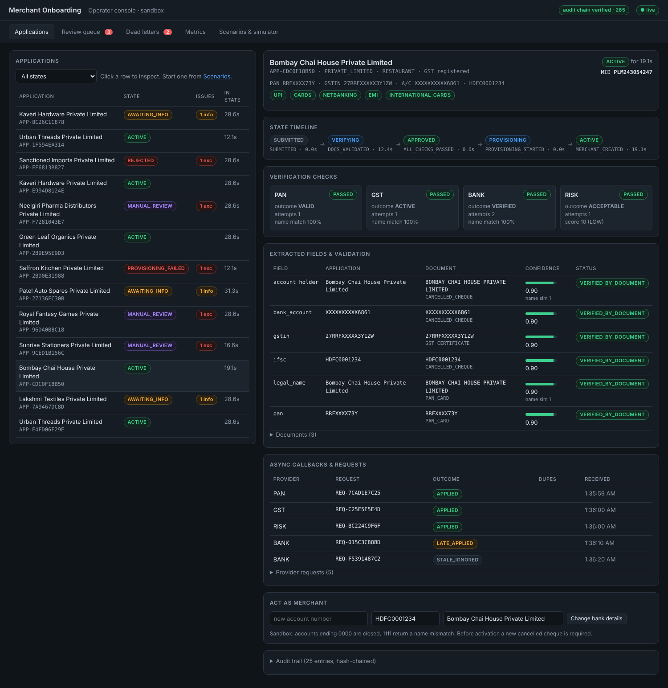
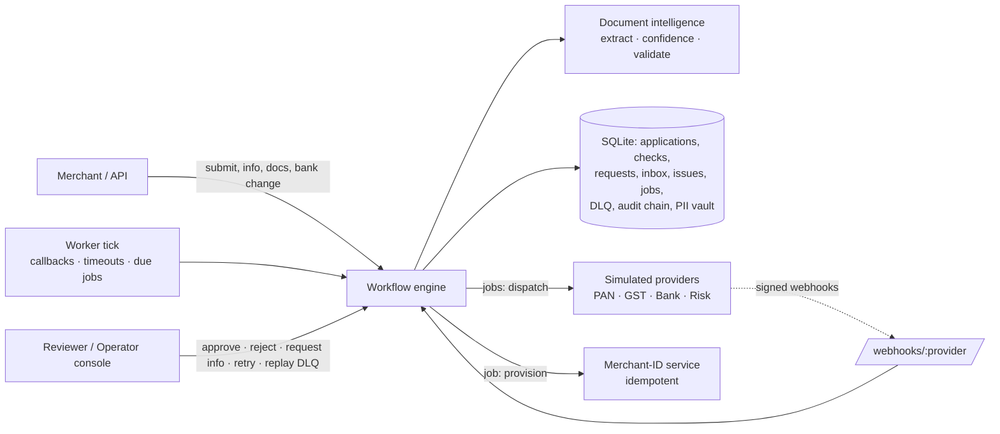
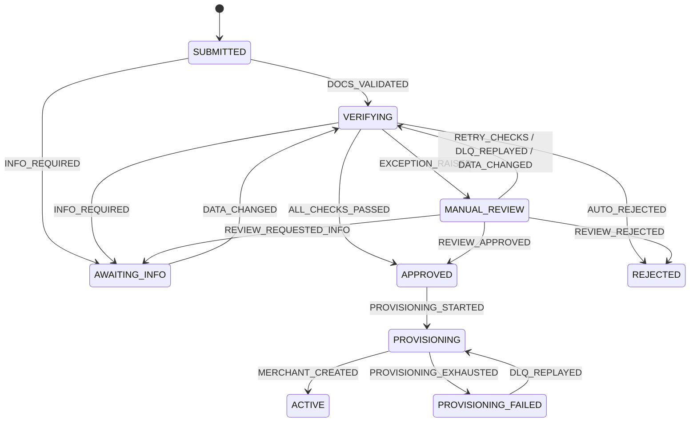
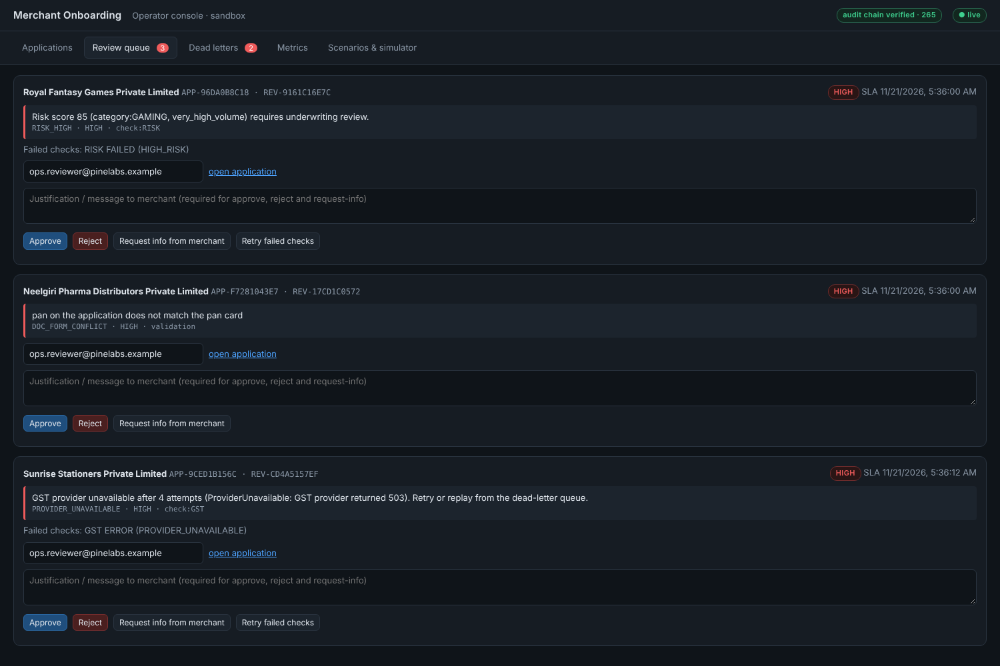
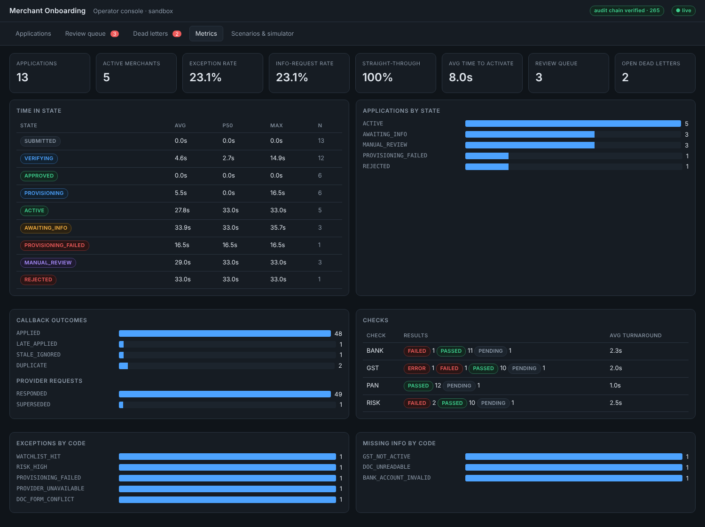
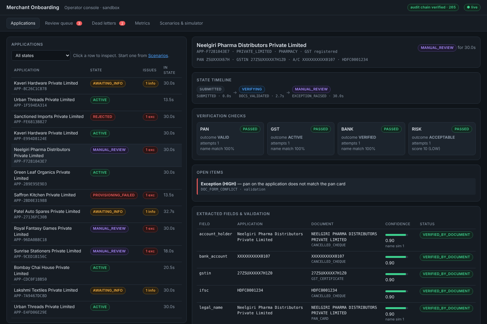
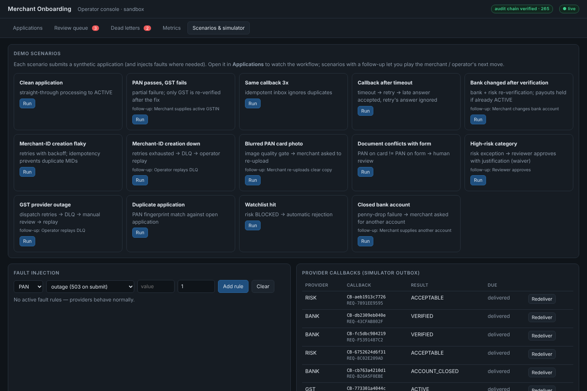

# Autonomous Merchant Onboarding Platform

A working vertical slice of merchant onboarding for a payments company. An application and its KYC documents go in. The system extracts and cross-checks fields with confidence scores, then runs **asynchronous** PAN, GST, bank (penny-drop) and risk verifications. It survives duplicate, late and lost callbacks, sends exceptions to a human review queue, and creates a merchant ID **only when the configured checks pass**. Every step goes into a tamper-evident audit trail.

> Problem statement 1 of 3 (Pine Labs assignment). This one was picked because it is the company's core business, and every listed failure scenario can be shown deterministically.



## Quick start

```bash
pip install -r requirements.txt     # Python 3.11+
python run.py                       # http://localhost:8000  (console)  ·  /docs (OpenAPI)
python -m pytest                    # 45 tests, ~3 s, fully deterministic (simulated clock)
python scripts/demo.py              # narrated run of all 14 scenarios, no server needed
python scripts/demo.py late_callback
```

In the console, open **Scenarios & simulator** and click **Run** on any scenario, then watch it in **Applications**. Scenarios with a follow-up (merchant fixes data, reviewer approves, operator replays the DLQ) show a ▶ button on the application.

Docker: `docker build -t onboarding . && docker run -p 8000:8000 onboarding`

## Minimum demonstration (what to show in 3 minutes)

1. **Run "Callback after timeout".** The BANK request times out at 8 s and a retry is sent. The original answer then arrives while the retry is in flight. It is accepted (`LATE_APPLIED`) because the data it verified hasn't changed. The retry's answer is ignored (`STALE_IGNORED`). PROVISIONING runs, then the application goes ACTIVE with a merchant ID.
2. **Run "PAN passes, GST fails".** The application goes to AWAITING_INFO with a clear message to the merchant. Press ▶: only GST is re-verified, and the PAN result is reused. It then goes ACTIVE.
3. **Run "Document conflicts with form".** It goes to MANUAL_REVIEW. In the **Review queue**, try to approve, reject or request info.
4. **Metrics** shows time in state, exception rate, callback outcomes and DLQ size. The header badge shows that the audit chain verifies.

## Architecture



* **Durable, event-driven state machine.** Every input (merchant action, provider callback, timer, reviewer decision) is handled in one DB transaction. State, issues, jobs and audit entries always change together. Outbound work goes through a durable **job queue** (outbox), so a crash never loses a dispatch or provisioning step. `test_workflow_survives_restart` kills the engine mid-verification and recovers through timeouts and retries.
* **Explicit transitions.** `onboarding/states.py` holds the only allowed `(state, event) → state` pairs. Anything else raises `InvalidTransition`, so ACTIVE can't be reached without APPROVED → PROVISIONING.
* **Decision point.** Routing happens only once every required check has settled. A watchlist hit means auto-reject. Missing info goes to AWAITING_INFO and exceptions go to MANUAL_REVIEW. Everything passed or waived means APPROVED, then provisioning.
* **Check reconciliation.** Each check stores a keyed hash of the exact inputs it verified. When data changes (new GSTIN, new bank account), only checks whose inputs changed are invalidated and re-run.

### State machine



Check states: `PENDING → IN_FLIGHT → (RETRY_SCHEDULED →)* PASSED | FAILED | ERROR`, plus `WAIVED` (reviewer) and `SKIPPED` (not required by policy).

## Failure scenarios: how each is handled

| Scenario (brief) | Handling | Test |
|---|---|---|
| PAN succeeds, GST fails | GST `CANCELLED` raises a merchant-facing issue and goes to AWAITING_INFO. The fix re-runs **only GST**, because PAN inputs are unchanged. Declaring "not GST-registered" turns GST to SKIPPED. | `test_pan_passes_gst_fails_then_only_gst_is_reverified` |
| Same callback arrives multiple times | Inbox keyed by provider event id: the first is applied, repeats are counted and acknowledged (200). A second event for an already-answered request is also a duplicate. | `test_duplicate_callbacks_are_idempotent` |
| Callback after the request timed out | Timeout leads to a retry with backoff. A late answer is **accepted** if the check is unresolved and the verified data is unchanged, and the outstanding retry is superseded. Otherwise the answer is ignored as stale. If retries run out, the check goes to ERROR, then the DLQ and review. | `test_late_callback_after_timeout_is_reconciled`, `test_late_callback_for_changed_data_is_ignored` |
| Merchant changes bank details after verification | BANK and RISK are invalidated and re-verified. Before activation, a fresh cancelled cheque is required. **After activation, payouts are held** until both pass. Changes are blocked during provisioning. | `test_bank_change_*` (4 tests) |
| Approval succeeds, merchant-ID creation fails | Provisioning job retried with exponential backoff. The idempotency key (application id) means a "created but response lost" failure never makes a second MID. When retries are exhausted it goes to PROVISIONING_FAILED, then the DLQ, and the operator replays. | `test_mid_failures_are_retried_idempotently`, `test_mid_permanent_failure_goes_to_dlq_and_replays` |
| Blurred document / conflicts with form | A blur gate (variance of Laplacian) or an upstream blur flag asks the merchant to re-upload, **before any paid provider call**. A form/document mismatch goes to HIGH-priority review. A document older than the field edit is asked to be re-uploaded. | `test_blurred_document_*`, `test_document_conflict_*` |

Also covered: provider outage → DLQ → reviewer retry, approval guard, high-risk waiver, watchlist auto-reject, duplicate application, shared bank account (mule signal), PAN holder type vs business type, auto-fill from documents, webhook signatures, no PII in clear, audit tampering detection.

## Human in the loop

* Review tasks carry the reasons, failed checks, priority (HIGH = 4 h SLA, otherwise 24 h) and SLA-breach flags.
* Decisions: **Approve** (justification required), **Reject**, **Request info** (becomes a merchant-facing issue), **Retry failed checks**.
* **Approval cannot bypass configured checks.** Only `WAIVABLE_FAILURES` in `config.py` (name mismatches, high risk score) can be waived, and they are recorded as `WAIVED` with reviewer and note. An invalid PAN, closed account or check that never completed blocks approval with HTTP 409. `_start_provisioning` re-checks this as defence in depth.
* A finding a reviewer explicitly accepted is not re-raised on later re-validation.

## Document intelligence

| Input | Path |
|---|---|
| Structured payload (upstream OCR/IDP) | per-field confidence; blur flag respected |
| OCR text / `.txt` | document-specific patterns, confidence lowered for ambiguity |
| PDF | text layer via pypdf; scanned PDFs are rasterised and go down the image path |
| Image | blur gate, then **Claude multimodal extraction** if `ANTHROPIC_API_KEY` is set; otherwise routed to manual extraction |

Model output is treated as untrusted. Every value is re-validated: PAN format, **GSTIN mod-36 checksum**, IFSC, and the GSTIN must embed the PAN. Values that fail validation have confidence capped at 0.4, and the prompt tells the model to ignore instructions inside documents. Fields left empty on the form are auto-filled from high-confidence extractions, with source tracked.

## Sensitive data handling

* PAN, GSTIN and account numbers are **encrypted at rest** (Fernet) in a PII vault, with **masked** values for display and **keyed HMAC fingerprints** for duplicate detection without decryption.
* API responses, the console and audit entries only contain masked values. Free text (reviewer notes, errors) is redacted. A test scans the full DB dump and API output for raw identifiers.
* Data minimisation: the risk provider receives fingerprints, not raw PAN or account numbers. Raw document bytes are not stored (only a hash and encrypted extracted fields). Checks don't run on incomplete applications.
* Provider webhooks are authenticated with HMAC-SHA256 (`X-Signature`). Bad signatures get 401 and are audited.
* **Hash-chained audit log**: each entry commits to the previous one, and `GET /api/audit/verify` detects edits or deletions.

## Sandbox values (simulated providers)

| Provider | Trigger | Result |
|---|---|---|
| PAN | digits `0000` / `1111` | INVALID / NAME_MISMATCH |
| GST | 13th char of GSTIN `9` | CANCELLED |
| Bank | account ends `0000` / `1111` | ACCOUNT_CLOSED / NAME_MISMATCH |
| Risk | name contains `SANCTIONED`; category GAMING/CRYPTO/FOREX; volume > ₹5 Cr | BLOCKED; score raised |

Fault injection (`POST /api/simulator/chaos` or the console): `outage`, `latency_s`, `duplicates`, `drop`, MID `fail` / `lose_response`. Rules can be global or scoped to one application, which is how the scenarios run concurrently without interfering.

## API (selected)

| Method | Path | Purpose |
|---|---|---|
| POST | `/api/applications` | submit form + documents |
| POST | `/api/applications/{id}/documents` | multipart upload (image / PDF / text) |
| POST | `/api/applications/{id}/info` | merchant supplies missing info |
| PUT | `/api/applications/{id}/bank-details` | change settlement account |
| GET | `/api/applications[/{id}]` | operator views (masked) |
| GET / POST | `/api/review-queue`, `/api/review-tasks/{id}/decision` | human review |
| GET / POST | `/api/dead-letters`, `/api/dead-letters/{id}/replay` | DLQ |
| POST | `/webhooks/{provider}` | signed provider callbacks |
| GET | `/api/metrics`, `/api/audit/verify`, `/api/state-machine` | ops |

Full schema at `/docs`.

## Project layout

```
onboarding/
  states.py       explicit state machine + check statuses
  engine.py       workflow engine (handlers, decision point, reconciliation, jobs, DLQ, read models)
  extraction.py   document intelligence + cross-validation
  providers.py    simulated PAN/GST/bank/risk + merchant-ID service, fault injection
  dedupe.py       duplicate application / entity matching
  security.py     vault, masking, redaction, webhook signatures
  audit.py        hash-chained audit log
  metrics.py      operational metrics
  api.py          FastAPI routes;  static/index.html  operator console
  samples.py      synthetic data + 14 named scenarios
tests/            45 deterministic tests (FakeClock)
scripts/demo.py   narrated scenario runner
```

## Assumptions, mocks and limitations

**Mocked:** all external providers (PAN/NSDL, GSTN, penny-drop, risk engine) and the internal merchant-ID/capability service. They are in-memory simulators with realistic async behaviour. Callbacks are delivered in-process through the same code path as the HTTP webhook. Authentication and RBAC for operators are not implemented; reviewer identity is self-declared.

**Assumptions:** required checks are PAN, bank and risk, plus GST when the business is GST-registered. Documents required are the PAN card, a cancelled cheque and the GST certificate. Post-activation bank changes are verified by penny-drop and risk re-score while payouts are held, without re-collecting documents. Thresholds (confidence 0.75, name match 0.85, timeouts, retry counts) live in `config.py`.

**Limitations / next steps:**
- Single process with SQLite. Production would use Postgres with `SELECT … FOR UPDATE SKIP LOCKED` workers, or Temporal for workflows, plus a real message broker.
- No real OCR engine bundled. Images need the Claude extractor (`ANTHROPIC_API_KEY`) or manual review. The LLM path is unit-tested with a mocked transport, not against the live API.
- No circuit breaker per provider (retries + DLQ only), no four-eyes approval for high-risk waivers, and no data-retention jobs.
- Simulator state is in memory: a restart drops pending callbacks, which the platform recovers from via timeouts (deliberately tested).
- Dev encryption and fingerprint keys are used when env vars are absent. Set `ONBOARDING_ENCRYPTION_KEY` (a Fernet key), `ONBOARDING_FINGERPRINT_KEY` and `WEBHOOK_SECRET_<PROVIDER>` in any real deployment.

| Env var | Default |
|---|---|
| `ONBOARDING_DB` | `onboarding.db` |
| `CHECK_TIMEOUT_S` | `8` |
| `ANTHROPIC_API_KEY`, `EXTRACTION_MODEL` | unset, `claude-sonnet-5-5` |
| `HOST`, `PORT` | `127.0.0.1`, `8000` |

## More screenshots

| Review queue | Metrics |
|---|---|
|  |  |
| **Document conflict** | **Scenarios & fault injection** |
|  |  |
